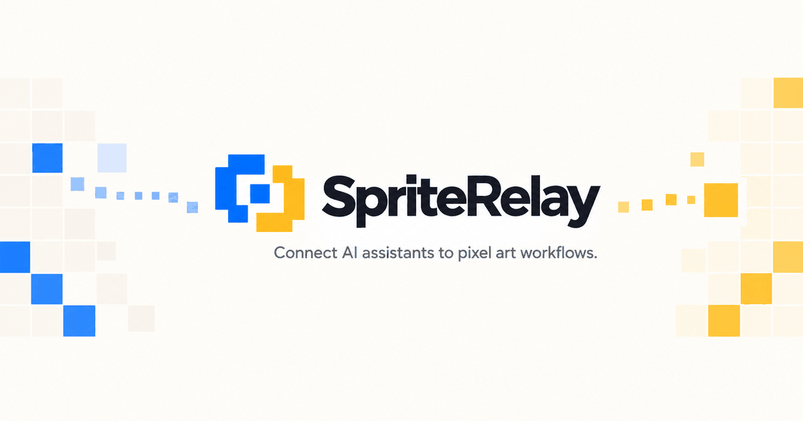
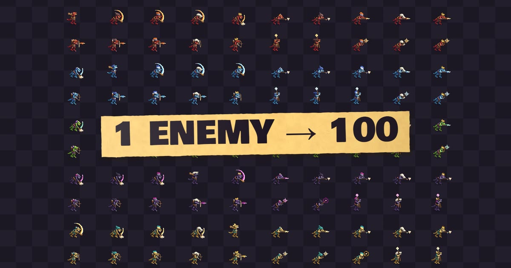
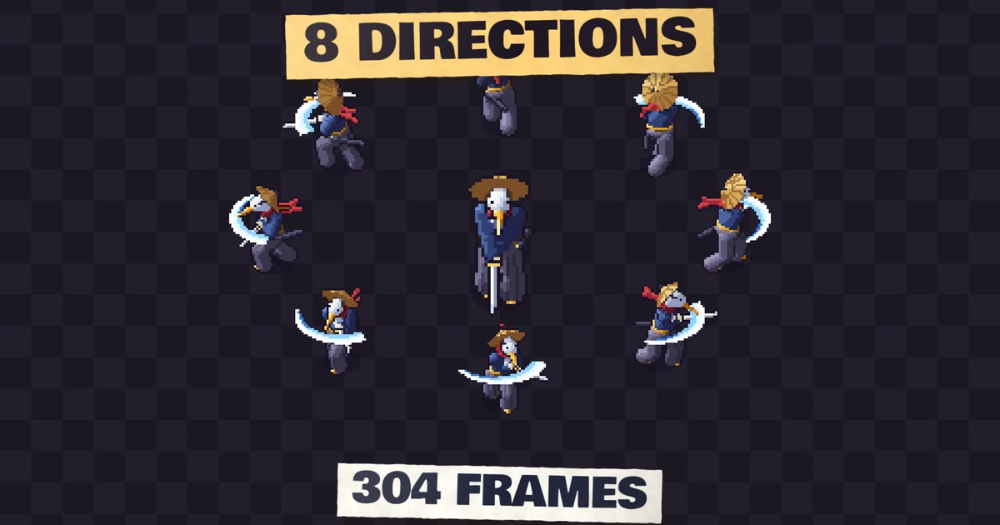
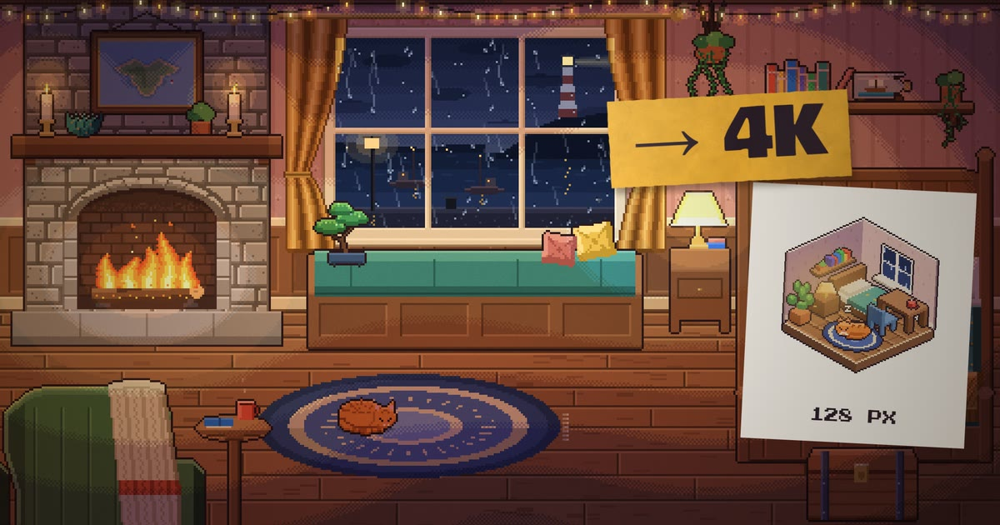
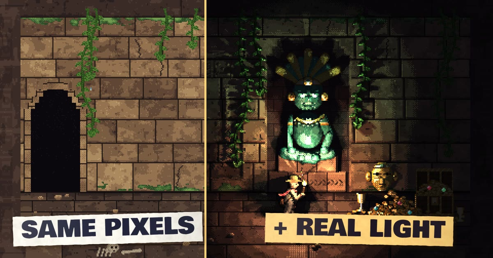
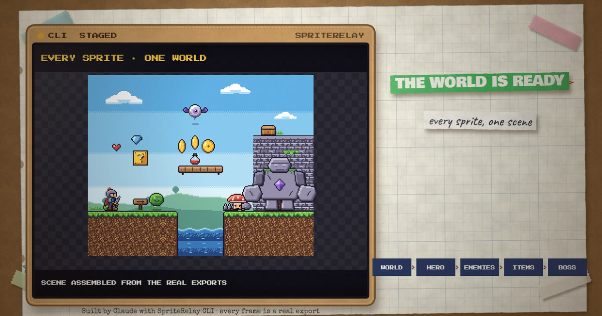
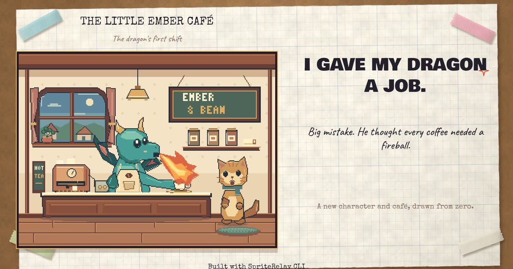

<p align="center">
  <a href="https://www.spriterelay.com/aseprite-mcp/">
    
  </a>
</p>

<h1 align="center">SpriteRelay: Aseprite MCP Server for AI Pixel Art</h1>

<p align="center">
  <strong>Let Claude, Codex, Cursor and other AI assistants build and edit real <code>.aseprite</code> files in Aseprite.</strong><br>
  Layers, frames, animation tags and palettes stay editable, live in the open editor or staged for safe batch work.
</p>

<p align="center">
  <a href="https://www.spriterelay.com/aseprite-mcp/">Website</a> ·
  <a href="https://www.spriterelay.com/setup/">Setup guide</a> ·
  <a href="https://www.spriterelay.com/builds/">Examples</a> ·
  <a href="https://www.spriterelay.com/technical-reference/">Technical reference</a> ·
  <a href="https://www.spriterelay.com/#purchase">Pricing</a> ·
  <a href="https://www.youtube.com/@SpriteRelay">YouTube</a>
</p>

---

## What is SpriteRelay?

**SpriteRelay is local Aseprite MCP software.** It uses the [Model Context Protocol (MCP)](https://modelcontextprotocol.io) to give your AI assistant structured tools for [Aseprite](https://www.aseprite.org), the pixel art and sprite animation editor. You describe what you want; the assistant inspects, edits, previews and exports the actual Aseprite document.

**It is not an AI image generator.** It doesn't paint a picture that looks like pixel art. The pixels are placed on Aseprite's own grid, inside a real file with named layers, frames, tags, palettes and tilemaps, which you can open and keep editing afterwards.

- 🎨 **Real `.aseprite` files:** layers, frames, animation tags, slices, palettes and tilemaps
- ⚡ **Live editing:** change the sprite open in Aseprite right now; each patch is **one native undo step**
- 🛡️ **Staged automation:** batch work happens in a copy; nothing reaches your project until you commit, with backups, journals and rollback
- 👀 **Review before you keep:** render previews and animated GIFs inline before anything is written
- 🔒 **Local and private:** runs on your machine, no account; SpriteRelay doesn't upload your artwork
- 🧩 **Works with the AI client you use:** Claude Code, Claude Desktop, Codex, Cursor, VS Code with Copilot and other stdio MCP clients

---

## See what it builds

Every image below comes from a real file built step by step by an AI agent through SpriteRelay, with every frame a real export. [Browse all 13 builds →](https://www.spriterelay.com/builds/)

<table>
  <tr>
    <td width="50%" align="center">
      <a href="https://www.spriterelay.com/builds/hundred-enemies/"></a><br>
      <strong><a href="https://www.spriterelay.com/builds/hundred-enemies/">One enemy, a hundred enemies</a></strong><br>
      One kobold, cut and palette-swapped into 100 game-ready files
    </td>
    <td width="50%" align="center">
      <a href="https://www.spriterelay.com/builds/eight-directions/"></a><br>
      <strong><a href="https://www.spriterelay.com/builds/eight-directions/">One sprite, eight directions</a></strong><br>
      A 64×64 swordsman: idle, walk, attack, hurt and death, 304 frames
    </td>
  </tr>
  <tr>
    <td width="50%" align="center">
      <a href="https://www.spriterelay.com/builds/cozy-room/"></a><br>
      <strong><a href="https://www.spriterelay.com/builds/cozy-room/">Cozy rainy night</a></strong><br>
      A 480×270 animated room: 672 frames, 17 tags, 11 layers
    </td>
    <td width="50%" align="center">
      <a href="https://www.spriterelay.com/builds/light-a-pixel-sprite/"></a><br>
      <strong><a href="https://www.spriterelay.com/builds/light-a-pixel-sprite/">Light a pixel sprite</a></strong><br>
      Colour, normal and data maps in one file, lit in real time
    </td>
  </tr>
  <tr>
    <td width="50%" align="center">
      <a href="https://www.spriterelay.com/builds/tiny-world/"></a><br>
      <strong><a href="https://www.spriterelay.com/builds/tiny-world/">Build a tiny game world</a></strong><br>
      A 16×16 platformer tileset and level on real tilemap layers
    </td>
    <td width="50%" align="center">
      <a href="https://www.spriterelay.com/builds/dragon-cafe/"></a><br>
      <strong><a href="https://www.spriterelay.com/builds/dragon-cafe/">Ember &amp; Bean, the dragon café</a></strong><br>
      A 320×240 animated scene with 13 editable layers
    </td>
  </tr>
</table>

🎮 **Try the real exports in your browser:** [Enemy Forge](https://www.spriterelay.com/play/enemy-forge/) · [Play the Heron](https://www.spriterelay.com/play/heron/) · [Light the Temple](https://www.spriterelay.com/play/temple-light/)

📺 **Watch it work:** [Live demo](https://www.youtube.com/watch?v=rB5QpSXjFnI) · [CLI demo](https://www.youtube.com/watch?v=3Jkc_tg9sJs) · [Setup tutorial](https://www.youtube.com/watch?v=Jd0EIc63IDE)

---

## Live or CLI: two ways to work

**Live when creating. CLI when shipping.** Buy either one, or both as **SpriteRelay Complete**.

| | **SpriteRelay Live** | **SpriteRelay CLI** |
|---|---|---|
| **Works on** | The document open in Aseprite right now | A retained, staged working copy |
| **Aseprite open?** | Yes, with the SpriteRelay Live Bridge extension | No: it launches your licensed Aseprite in batch mode |
| **Where edits land** | Immediately, in the attached document | In the staged copy until you run `file_commit` |
| **How you recover** | One labelled native undo step per existing-document patch | Overwrites create backups; manifest commits add journals, verification and rollback |
| **Best for** | Visual iteration while you draw | Repeatable batch production, exports and release work |

---

## The MCP tools

Each product exposes **six tools**: a compact surface instead of hundreds of endpoints. Both accept **validated operations only**; neither exposes a raw-Lua or arbitrary-code channel.

<details>
<summary><strong>SpriteRelay CLI tools</strong> (166 public patch operations)</summary>

| Tool | What it does |
|---|---|
| `aseprite_doctor` | Finds your Aseprite, validates the version and Lua environment, and reports what the installation can do |
| `sprite_inspect` | Reads sprites, directories, manifests, recipes, rendered pixels and the operation catalog, so the agent looks before it edits |
| `sprite_patch` | Validates an ordered operation list and applies it to a staged copy |
| `sprite_export` | Produces staged images, documents, palettes, masks, metadata, batches, atlases and variants |
| `sprite_preview` | Renders a still image or animated GIF you can review before committing |
| `file_commit` | Promotes staged artifacts, verifies them, manages journals and rolls back. The only tool that writes where you told it to |

</details>

<details>
<summary><strong>SpriteRelay Live tools</strong> (216 public patch operations)</summary>

| Tool | What it does |
|---|---|
| `live_doctor` | Checks the server, the Bridge, and that their versions match |
| `live_session` | Attaches to a document, reports status, undoes, redoes and reads editor state |
| `live_inspect` | Reads context from the document you have open |
| `live_patch` | Edits the attached document: one patch, one native undo step (new-document creation excepted) |
| `live_preview` | Renders the active frames and tags |
| `live_export` | Stages, commits and rolls back exports |

</details>

Full counting rules, modes and limits: [technical reference](https://www.spriterelay.com/technical-reference/).

---

## Supported AI clients

Any MCP client that runs **local stdio servers**, including:

**Claude Code** · **Claude Desktop** · **Codex** (CLI, IDE extension and ChatGPT desktop app) · **Cursor** · **VS Code** with GitHub Copilot · **Windsurf** · **Cline** · **Zed** · **Continue** · **Gemini CLI** · **JetBrains AI Assistant**

## Requirements

- **Aseprite**, licensed and installed by you
  - CLI: Aseprite **1.3.18.1** with Lua API 40 (current baseline; version-sensitive features are capability-gated)
  - Live: Aseprite **1.3-rc5 or newer** with Lua API 25 or newer
- **Node.js 18** or newer
- An **MCP client** that supports local stdio servers

---

## Quick start

SpriteRelay is delivered to buyers as `.tgz` packages (release 2.0.0). **There is no public npm package, so never install a similarly named package from the registry.** The full walkthrough, including Live pairing and troubleshooting, is in the [setup guide](https://www.spriterelay.com/setup/).

**1. Install the package you received**

```bash
npm install -g "/absolute/path/to/spriterelay-cli-2.0.0.tgz"
```

**2. Register it with your AI client**

Claude Code:

```bash
claude mcp add --transport stdio --scope user spriterelay -- /absolute/path/to/node /absolute/path/to/spriterelay-cli/dist/index.js
```

Codex:

```bash
codex mcp add spriterelay -- /absolute/path/to/node /absolute/path/to/spriterelay-cli/dist/index.js
```

Claude Desktop, Cursor and other JSON-configured clients: merge this into `mcpServers` (on Windows, double every backslash):

```json
{
  "mcpServers": {
    "spriterelay": {
      "command": "/absolute/path/to/node",
      "args": ["/absolute/path/to/spriterelay-cli/dist/index.js"],
      "env": { "ASEPRITE_PATH": "/absolute/path/to/aseprite" }
    }
  }
}
```

**3. Check the connection and make a first edit**

> Run spriterelay's aseprite_doctor with level quick and report discovery, Aseprite version, API version, and unsupported capabilities.

> Draw a small purple potion on a 32×32 canvas and show me a preview.

With **Live**, the change appears in the open document as one undo step. With **CLI**, it happens in a staged copy, and nothing reaches your project until you ask for `file_commit`.

---

## Pricing

One-time purchase, no subscription, per-user licence. Aseprite is licensed separately.

| Edition | Includes | Price |
|---|---|---|
| **SpriteRelay Complete** ⭐ | Live + matched Bridge + CLI | **$14.99** once |
| **SpriteRelay Live** | Live + matched Bridge | $11.99 once |
| **SpriteRelay CLI** | CLI | $7.99 once |

👉 **[Get SpriteRelay](https://www.spriterelay.com/#purchase)**

---

## FAQ

<details>
<summary><strong>What is Aseprite MCP?</strong></summary>

A Model Context Protocol workflow that gives a compatible AI assistant structured tools for Aseprite, so it can read and edit sprites instead of only describing them. Read the [Aseprite MCP guide](https://www.spriterelay.com/aseprite-mcp/).
</details>

<details>
<summary><strong>Is this an AI image generator?</strong></summary>

No. SpriteRelay gives your AI assistant structured tools to build and edit real `.aseprite` files: layers, frames, tags, palettes, tilemaps and exports. The pixels are placed on Aseprite's own grid, and the file stays editable by you afterwards.
</details>

<details>
<summary><strong>Will it overwrite my source files?</strong></summary>

CLI changes staged copies until `file_commit`. Live patches the open document but does not save it to disk; existing-document patches form one undo step, with new-document creation as the exception. Permanent exports require an explicit commit.
</details>

<details>
<summary><strong>Does SpriteRelay upload my artwork?</strong></summary>

SpriteRelay itself does not upload artwork during ordinary use; core processing and optional diagnostics stay on your device. Your MCP client or AI provider may process data under its own privacy terms. See [security and privacy](https://www.spriterelay.com/security-and-privacy/).
</details>

<details>
<summary><strong>Can the agent execute arbitrary Lua?</strong></summary>

No. Both products accept validated operations; neither exposes a raw-Lua or arbitrary-code channel.
</details>

<details>
<summary><strong>Is the source code in this repository?</strong></summary>

No. This repository holds documentation, setup examples and showcase images. SpriteRelay is distributed to buyers as private packages; see [pricing](https://www.spriterelay.com/#purchase).
</details>

More answers on the [website FAQ](https://www.spriterelay.com/#faq).

---

## Support

- 📧 **Email:** [support@spriterelay.com](mailto:support@spriterelay.com). Include your client, operating system and the doctor's output.
- 📖 **Docs:** [Setup guide](https://www.spriterelay.com/setup/) · [Technical reference](https://www.spriterelay.com/technical-reference/) · [Aseprite MCP guide](https://www.spriterelay.com/aseprite-mcp/)
- 📜 **Licence:** proprietary, per-user. See the [EULA](https://www.spriterelay.com/eula).

---

<p align="center">
  <sub>SpriteRelay is local Aseprite MCP software from Sprite Relay Software Limited Company.<br>
  Aseprite is required and licensed separately. SpriteRelay is not affiliated with Aseprite.</sub>
</p>
